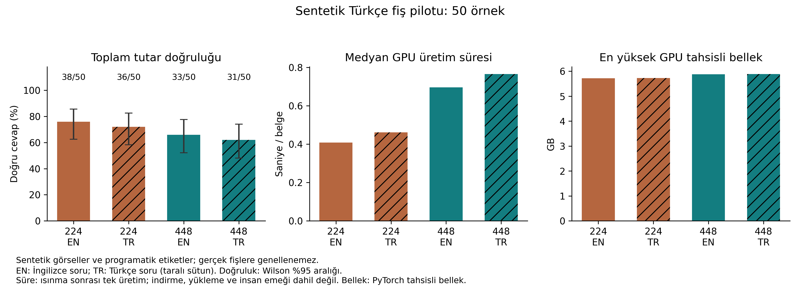

# PaliGemma 2 Türkçe fiş okuyabiliyor mu?

Freya Research Fellows programında PaliGemma 2 makalesini okurken iki şeyi merak ettim:

1. mix-448, Türkçe fiş toplamlarını mix-224'ten daha doğru okuyor mu?
2. Aynı isteği Türkçe sormak ile İngilizce sormak arasında fark var mı?

Her belge dört koşulda okunur: iki model × iki soru dili.

|                | İngilizce soru | Türkçe soru |
| -------------- | -------------- | ----------- |
| `mix-224`      | 224-en         | 224-tr      |
| `mix-448`      | 448-en         | 448-tr      |

## İlk sonuç: sentetik pilot (50 fiş)

Colab T4 GPU'da, 27 Ekim 2026. 50 programatik Türkçe fiş × 4 koşul = 200 cevap. Ölçüt: ödenecek toplamın kuruşuna kadar doğru ve tek tutar olarak yazılması.

| Model     | Soru dili | Doğru     | %95 aralık | Biçim hatası | Yanlış tutar | Medyan süre |
| --------- | --------- | --------- | ---------- | ------------ | ------------ | ----------- |
| `mix-224` | İngilizce | 38/50 %76 | 63–86      | 3            | 9            | 0,41 sn     |
| `mix-224` | Türkçe    | 36/50 %72 | 58–83      | 10           | 4            | 0,46 sn     |
| `mix-448` | İngilizce | 33/50 %66 | 52–78      | 7            | 10           | 0,70 sn     |
| `mix-448` | Türkçe    | 31/50 %62 | 48–74      | 14           | 5            | 0,77 sn     |



Ne gördüm:

1. **448 daha iyi okumadı.** İki dilde de 224'ün 10 puan gerisinde ve yaklaşık 1,7 kat yavaş. 50 fişte bu fark anlamlı değil (eşleştirilmiş McNemar p≈0,27–0,33). Yani bu sette çözünürlüğün faydası görülmedi.
2. **Türkçe soru sayı biçimini bozuyor.** Türkçe sorudaki hataların çoğu biçim hatası: model `1.551,13` yerine `1,551,13 TL` yazıyor. Rakamlar doğru, ayıraçlar karışık. Sadece rakamlara bakınca 448-Türkçe 31'den 45'e, 224-Türkçe 36'dan 43'e çıkıyor; iki İngilizce koşul 40'ta kalıyor. Resmi skor değişmiyor; kural koşudan önce donduruldu.
3. **İngilizce soruda hata türü farklı.** Biçim daha temiz ama model daha sık yanlış satırı okuyor ve toplam yerine bir ürün fiyatı veriyor.

Bu fişler programla çizildi; gerçek fotoğraf değil. Sonuçlar gerçek fiş başarımını göstermez. Rapor, özet ve ham cevaplar [`results/synthetic_pilot/`](results/synthetic_pilot/) içinde.

**Gerçek fiş deneyi:** Kaynak kontrolünden geçmiş 49 gerçek görüntü var. Referans toplamları insan doğrulaması bekliyor; henüz koşulmadı.

## Ölçüm

- **Görev:** Fişte ödenecek nihai toplamı bulmak. Fatura ve irsaliye kapsam dışı.
- **Ana ölçüt:** Tutar kuruşuna kadar doğru mu? Açıklamalı, birden fazla tutar içeren veya okunamayan cevaplar başarısız sayılır.
- **Ek ölçümler:** Yanlış sayı mı, biçim hatası mı; GPU üretim süresi ve tahsisli bellek.
- **İstatistik:** Aynı fişler her koşulda kullanılır: Wilson aralıkları, eşleştirilmiş bootstrap ve exact McNemar testi.
- **Ana karşılaştırma:** Türkçe soruda mix-448 eksi mix-224. Diğer üç karşılaştırma keşifseldir.

Sorular `pg2receipts/__init__.py` içinde sabit. Test cevapları görüldükten sonra soru değiştirilmemelidir.

## Colab’da çalıştırma

[Colab’da aç](https://colab.research.google.com/github/karakustugce/paligemma2-turkish-receipts/blob/main/notebooks/colab_evaluation.ipynb)

Önce **Çalışma zamanı → Çalışma zamanı türünü değiştir → T4 GPU** seçin. [mix-224](https://huggingface.co/google/paligemma2-3b-mix-224) ve [mix-448](https://huggingface.co/google/paligemma2-3b-mix-448) sayfalarında Google erişim koşullarını kabul edin. Defter varsayılan olarak sentetik pilotu üretir; gerçek fiş yoluna geçmek için veri modu hücresindeki seçimi değiştirin. Hugging Face token’ını deftere yazmayın veya paylaşmayın.

Sentetik pilotu kendi bilgisayarınızda hazırlamak için:

```bash
python -m pip install -r requirements.txt
python -m pg2receipts.synthetic --out data/synthetic_pilot --count 50 --seed 2026
python -m pg2receipts.run --manifest data/synthetic_pilot/manifest.csv --images data/synthetic_pilot/images --out results/synthetic_run
python -m pg2receipts.analyze --run results/synthetic_run
```

Gerçek fişler için `data/manifest_template.csv` dosyasını `data/manifest.csv` olarak kopyalayıp doldurun, görüntüleri `data/images/` içine koyun ve her gerçek toplamı model koşusundan önce insan gözüyle doğrulayın. Ayrıntılar [veri ve deney rehberinde](docs/VERI_VE_DENEY.md); sentetik veri tasarımı [sentetik veri notunda](docs/SENTETIK_VERI.md), gerçek kaynak örneklem ise [kaynak notunda](docs/KAYNAK_VERI.md).

Kendi CUDA GPU’nuzda model erişimini kabul ettikten sonra `hf auth login` ile giriş yapın. Koşu yarıda kesilirse aynı veri ve ortamla `--resume` ekleyin. Soru, etiket, görüntü veya yazılım sürümü değişirse yeni bir çıktı klasörü kullanın.

## Çıktılar

Koşu ve analizden sonra:

- `report.md`: dört koşulun doğruluk tablosu ve eşleştirilmiş karşılaştırmalar
- `summary.json`: sonuçlar, güven aralıkları ve veri türü
- `accuracy_and_resources.png`: doğruluk, GPU süresi ve bellek grafiği
- `predictions.jsonl`: modelin ham yanıtları ve skorlar
- `run_config.json`: checkpoint sürümleri, sorular, görüntü hash’leri ve veri kökeni

Sentetik veri analizinde ekonomik senaryo grafiği özellikle üretilmez. Modelin sentetik görsellerdeki hatası, gerçek iş akışındaki düzeltme süresini veya tasarrufu göstermez.

## Sınırlar

- Sentetik örnekler programatik olarak çizilir; gerçek fotoğraf, gerçek işletme veya gerçek işlem kaydı değildir. Bunlardaki skorlar gerçek fiş performansını göstermez.
- 49 gerçek fişli yol da küçük ve tek kaynaklı bir örneklemdir; tüm Türkçe belgeleri temsil etmez.
- `mix-224` ve `mix-448` farklı eğitilmiş checkpoint’lerdir. Fark yalnız çözünürlükten kaynaklanmayabilir.
- Türkçe ve İngilizce soruların görev önekleri de farklıdır; fark yalnız çeviri etkisi olarak yorumlanamaz.
- Gerçek iş gücü süreleri ölçülmediği sürece ekonomik tasarruf iddiası kurulmaz.

## Kaynaklar

- [PaliGemma 2 makalesi](https://arxiv.org/abs/2412.03555)
- [Umar Jamil: PaliGemma'yı sıfırdan kodlamak](https://www.youtube.com/watch?v=vAmKB7iPkWw)
- [Transformers PaliGemma dokümantasyonu](https://huggingface.co/docs/transformers/v4.57.1/model_doc/paligemma)

Tuğçe Karakuş